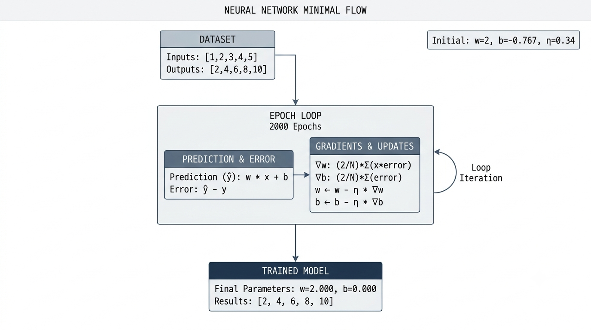

# Single-Neuron Neural Network (Linear Regression)

[](https://www.python.org/downloads/)
[](#prerequisites)

A from-scratch implementation of a single-neuron neural network in pure Python, built without any external machine learning libraries. This project demonstrates, step by step, how gradient descent optimizes a weight and bias to learn a simple linear pattern: **y = 2x**.

It is intended as an educational reference for understanding the mechanics behind neural network training — forward passes, loss computation, and backpropagation — without the abstraction of a framework like TensorFlow or PyTorch.

---

## Table of Contents

- [Overview](#overview)
- [Architecture & Training Flow](#architecture--training-flow)
- [How It Works](#how-it-works)
- [Prerequisites](#prerequisites)
- [Getting Started](#getting-started)
- [Example Output](#example-output)
- [Project Structure](#project-structure)

---

## Overview

|                       |                                                           |
| --------------------- | --------------------------------------------------------- |
| **Task**              | Linear regression via gradient descent                    |
| **Model**             | Single neuron (1 weight, 1 bias)                          |
| **Dataset**           | `inputs = [1, 2, 3, 4, 5]` → `outputs = [2, 4, 6, 8, 10]` |
| **Target function**   | y = 2x                                                    |
| **Epochs**            | 2,000                                                     |
| **Learning rate (η)** | 0.35                                                      |
| **Dependencies**      | None (pure Python standard library)                       |

## Architecture & Training Flow



## How It Works

The model is trained on a small dataset and learns the underlying relationship through iterative training:

1. **Dataset** — Maps `inputs = [1, 2, 3, 4, 5]` to `outputs = [2, 4, 6, 8, 10]`.
2. **Prediction** — Uses the standard linear equation:

   $$\hat{y} = w \cdot x + b$$

3. **Loss Calculation** — Measures accuracy using Mean Squared Error (MSE):

   $$\text{Loss} = \frac{1}{N} \sum_{i=1}^{N} (\hat{y}_i - y_i)^2$$

4. **Gradient Descent** — Over 2,000 epochs, the script calculates the gradients of the loss with respect to both the weight (`w`) and bias (`b`), and updates them using a learning rate (η = 0.35) to iteratively minimize the loss.
5. **Interactive Inference** — Once training completes, the model prints its learned parameters, validates itself against the original dataset, and prompts the user to enter a custom number for live prediction.

## Prerequisites

- **Python 3.x** installed on your system (Windows, macOS, or Linux).
- No third-party dependencies — the script uses only built-in Python functionality.

## Getting Started

1. **Clone or download** this repository to your local machine.

   Ensure the image file `low_chart.png` remains in the same directory as `README.md`, or update the image path above accordingly.

2. **Open a terminal** and navigate to the project directory, then run the script for your operating system:

   **Windows (Command Prompt / PowerShell)**

   ```bash
   python main.py
   ```

   **macOS / Linux (Terminal)**

   ```bash
   python3 main.py
   ```

3. **Follow the prompts** after training completes to test the model with your own numeric inputs.

## Example Output

```text
Final weight: 2.0
Final bias: 0.0

Predictions:
1 -> 2.0
2 -> 4.0
3 -> 6.0
4 -> 8.0
5 -> 10.0
-------------------CUSTOM INPUTS----------------------
Enter value: 12
24.0
```

## Project Structure

```text
├── main.py                                       # Core training loop and prediction script
├── low_chart.png  # Architecture & flow diagram
└── README.md                                     # Project documentation
```
